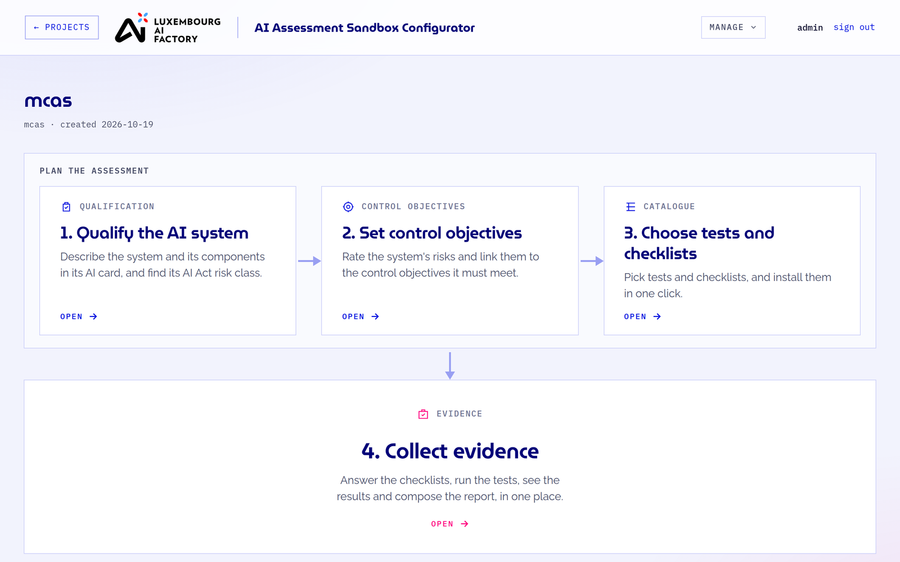
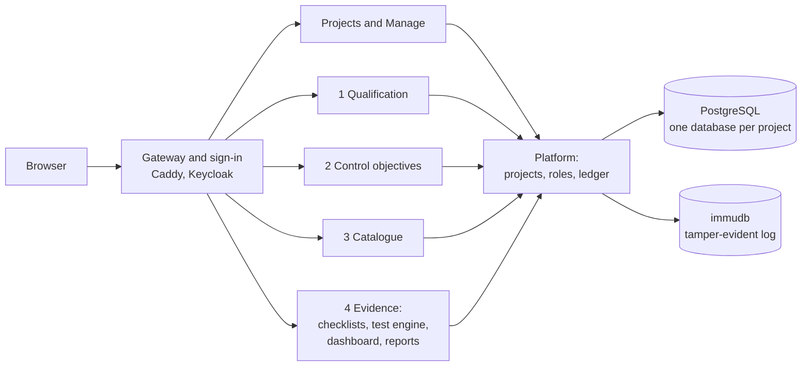

# AI Assessment Sandbox Configurator (AISC)

[](https://github.com/lux-ai-factory/aisc/actions/workflows/ci.yml)
[](LICENSE.md)
[](https://arxiv.org/abs/2509.25256)

AISC helps a team plan and carry out the technical assessment of an AI system against the EU AI Act. It runs on
your own computer or server, and keeps every project, answer, test result and report in one place.



## What it does

Each project assesses one AI system, in four steps:

1. **Qualify the AI system.** Describe the system and its components in an AI card, and find its AI Act risk class.
2. **Set control objectives.** Rate the system's risks and link them to the control objectives it must meet.
3. **Choose tests and checklists.** Pick them from the catalogue and install them in one click.
4. **Collect evidence.** Answer the checklists, run the tests, look at the results and compose the report.

Along the way, AISC:

- runs technical tests on the system (for example fairness, robustness, performance and jailbreak tests) through plugins;
- shows the results in a dashboard and produces the report as PDF or Word;
- gives each project its own members and roles, and its own database;
- records who changed what in a tamper-evident log.

AISC is built for regulatory sandboxes, supervisory authorities and the AI providers who work with them.

## Quick start

If you already have Docker and uv:

```
git -c core.autocrlf=false clone --recursive --branch feat/unified-modules https://github.com/lux-ai-factory/aisc.git
cd aisc
uv run scripts/aisc.py start
```

Then open the address the last message of `start` gives (<http://localhost:8100> unless it moved) and sign in
with the account that message names (`admin` / `admin` on a new install).

The first start builds every image (27 of them) on your computer, so it takes a while. Later starts are quick.
New to these tools? Follow the three steps below.

## Before you install

| You need | |
|---|---|
| **Computer** | Windows 10 or 11, macOS or Linux, on a 64-bit Intel or AMD processor (x86_64) |
| **Memory** | 8 GB of RAM free for AISC. On Windows and macOS, a computer with 16 GB is comfortable |
| **Disk** | 30 GB free |
| **Free ports** | 80, 8100, 8188, and 8081 on `127.0.0.1`. If one is taken, `start` moves AISC to a free one and tells you (not on an install served over https, which also needs 443) |
| **Internet** | While installing (GitHub, Docker Hub, PyPI, npm and Linux package mirrors) |
| **Accounts** | None. Everything AISC needs is public (a few optional test plugins are private and are skipped) |

**Tested so far:** Linux. The install works the same way on Windows and macOS, but nobody has run it there end
to end yet. Computers with Apple Silicon (M1 to M4) and other ARM processors are not tested. If you try one of
these, please [tell us how it went](https://github.com/lux-ai-factory/aisc/issues).

## 1. Install Docker and uv

AISC runs in Docker. [uv](https://docs.astral.sh/uv/) runs its install script and fetches the Python that
script needs. This is the only step that differs per system.

### Windows

1. **Check that you can install programs.** You need administrator rights on the computer. On a work laptop,
   ask your IT team first.

2. **Install Docker Desktop and uv.** Open PowerShell and run:

   ```powershell
   winget install --id Docker.DockerDesktop -e
   winget install --id astral-sh.uv -e
   ```

3. **Restart the computer**, then start **Docker Desktop** from the Start menu.
   - On its first start, Docker Desktop sets up WSL 2, the part of Windows that runs Linux programs. It may ask
     you to install an update or to restart again. Accept, and start Docker Desktop again afterwards.
   - If it says that virtualisation is turned off, it has to be turned on in the computer's BIOS or UEFI
     settings. How depends on the computer's brand; search for "enable virtualization" with your model.
   - Wait until Docker Desktop shows **Engine running**.

### macOS

1. **Install [Docker Desktop](https://www.docker.com/products/docker-desktop/)**, start it and wait until it
   shows **Engine running**.

2. **Install uv.** Open Terminal, run the line below, then close and reopen Terminal:

   ```bash
   curl -LsSf https://astral.sh/uv/install.sh | sh
   ```

### Linux

1. **Install Docker Engine 23 or later with the Compose plugin 2.17 or later**, following
   [Docker's instructions for your distribution](https://docs.docker.com/engine/install/). Let your user run
   Docker without `sudo` ([how](https://docs.docker.com/engine/install/linux-postinstall/)), then log out and in
   again. Check with `docker compose version`.

2. **Install uv:**

   ```bash
   curl -LsSf https://astral.sh/uv/install.sh | sh
   ```

## 2. Download and start AISC

The same on every system. Open a terminal (PowerShell on Windows) and run:

```
cd ~
git -c core.autocrlf=false clone --recursive --branch feat/unified-modules https://github.com/lux-ai-factory/aisc.git
cd aisc
uv run scripts/aisc.py start
```

> **Copy the clone command exactly.** The `-c core.autocrlf=false` part keeps the files in the form the Linux
> containers expect. If you cloned without it, delete the `aisc` folder and clone again.
>
> On Windows, keep the folder out of OneDrive: `cd ~` puts it in `C:\Users\<you>\aisc`, which is fine.

### What `start` does

`uv run scripts/aisc.py start` is the only command you need. It:

1. checks Docker, the download and the free disk space, and tells you what to fix if something is missing;
2. creates the passwords and keys for your install (they stay on your computer and are never uploaded);
3. checks the ports AISC needs, before building anything. If port 80, 8100, 8188 or 8081 is taken, AISC uses
   a free one instead (port 80 becomes 8080, for example), and `start` tells you. Your install keeps that port;
   an install served over https does not move, and stops instead;
4. builds the images and starts AISC;
5. waits until the sign-in page answers, then prints where to go.

When it ends with **AISC is up**, AISC is ready. You can run `start` again at any time: it keeps your data and
your passwords.

## 3. Open AISC

1. Open the address the last message of `start` gives in your browser. It is <http://localhost:8100> unless that
   port was taken and `start` moved it.
2. Sign in with the account named in the last message of `start`. On a new install that is `admin` / `admin`
   (a second account, `user` / `user`, has ordinary rights). These simple passwords are safe here because the
   sign-in only works from your own computer. An install served to others over https gets generated
   passwords instead, and `rotate-infra-password` changes them; both are kept as `AISC_ADMIN_PASSWORD` and
   `AISC_USER_PASSWORD` in `env.secrets`. Show them with `uv run scripts/aisc.py password`.
3. Click **Create project** and give the project a name.
4. Work through the four steps on the project page. Each card has an **Open** link.

The **Manage** menu, top right, holds the settings: components and connections to the systems you test, the
models and keys used by the AI assistant, the activity log and background tasks.

Some helpers, such as the assistant that fills in the AI card, use a language model. They need a model and an
API key, which an administrator adds under **Manage > AI assistant models and keys**.

## Everyday use

All commands run in the `aisc` folder.

| To | Run |
|---|---|
| Stop AISC | `docker compose -p aisc stop` |
| Start it again after stopping it | `uv run scripts/aisc.py start` |
| Update to the latest version | `git pull`, then `git submodule update --init --recursive`, then `uv run scripts/aisc.py start` |
| Check that everything works | `./scripts/verify.sh --stack` (macOS and Linux; it needs Python 3 and takes a while) |
| Remove AISC and all its data | `docker compose -p aisc down -v`, then delete the `aisc` folder |

After the computer restarts, AISC comes back by itself once Docker is running. If Docker Desktop does not start when
you sign in, start it. If a page still does not answer, run `uv run scripts/aisc.py start`.

`down -v` deletes every project for good. The images stay on disk (about 14 GB). Remove them from Docker
Desktop's **Images** page, or with `docker image prune -a` if you use Docker for nothing else.

## If something goes wrong

| What you see | What to do |
|---|---|
| "Docker is not running" | Start Docker Desktop (on Linux, the Docker service) and wait until it is running. Then run `start` again. |
| "Port ... is taken" | On a plain http install, nothing to do: `start` moved AISC to a free port and printed the new address. Open that address. On an https install, `start` names the port and the command that shows which program holds it (`netstat -ano \| findstr :443` in PowerShell, `sudo lsof -i :443` on macOS and Linux). Stop that program and run `start` again. |
| Port 80 or 443 is held by process 4 ("System") on Windows, on an install served over https | A Windows web service holds it, usually IIS. In **Services**, stop **World Wide Web Publishing Service** and set it to Manual. |
| The page shows **502** | AISC is still starting. Wait 30 seconds and reload. |
| The sign-in refuses you after a reinstall | Your browser kept a session from the old install. Use a private window. |
| On Windows, a container stops with `/bin/sh^M`, `bad interpreter` or `no such file` | The clone was made without `-c core.autocrlf=false`. Delete the `aisc` folder and clone again with the exact command. |
| `start` stopped halfway | Run it again. It removes what the failed attempt left half-made and goes on. |
| The build fails on the network or with "no space left on device" | Free disk space if needed, then run `start` again. What was already built is kept. |

Still stuck? [Open an issue](https://github.com/lux-ai-factory/aisc/issues) with the last lines `start` printed.

## How it fits together



Each step is its own application, most of them in a submodule of this repository. This repository ties them
together and runs them with Docker Compose behind one sign-in. [docs/guide.md](docs/guide.md) describes every
component.

## Documentation

- [docs/guide.md](docs/guide.md): components, how it works, configuration, passwords and keys, tests.
- [Your own plugins](docs/guide.md#your-own-plugins) and [your own checklists](docs/guide.md#your-own-controls).
- [lux-ai-factory/rfc](https://github.com/lux-ai-factory/rfc): architecture, mission and user guide.

## Contributing

Contributions are welcome. Read [CONTRIBUTING.md](CONTRIBUTING.md) first. Contributions are made under the
contributor license agreements in this repository ([individuals](<AISC ICLA (Individuals).txt>),
[entities](<AISC CCLA (Entities).txt>)).

## Citing AISC

If you use AISC in research, please cite:

```bibtex
@misc{buscemi2025sandboxconfigurator,
  title         = {The Sandbox Configurator: A Framework to Support Technical Assessment in AI Regulatory Sandboxes},
  author        = {Buscemi, Alessio and Simonetto, Thibault and Pagani, Daniele and Castignani, German and Cordy, Maxime and Cabot, Jordi},
  year          = {2025},
  eprint        = {2509.25256},
  archivePrefix = {arXiv},
  url           = {https://arxiv.org/abs/2509.25256}
}
```

## Acknowledgements

AISC is co-developed and co-maintained by the Interdisciplinary Centre for Security, Reliability and Trust (SnT)
of the University of Luxembourg and the Luxembourg Institute of Science and Technology (LIST). It is funded under
the Luxembourg AI Factory, Horizon Europe grant agreement No. 101234366.

## License

[Apache License 2.0](LICENSE.md). © 2024–2026 University of Luxembourg and Luxembourg Institute of Science and
Technology.
