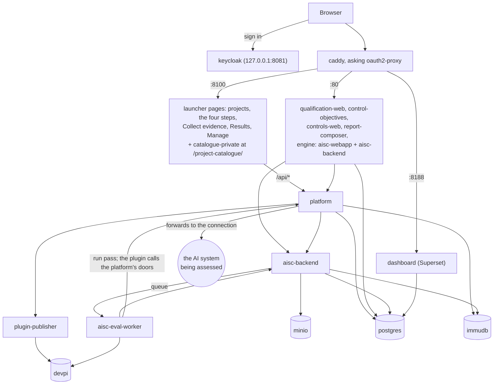

# How AISC works

This document explains what AISC is made of and what each step of an assessment is for. The
[README](../README.md) says how to install it; the [guide](guide.md) is the operator's reference (every component,
setting, port and test). One appendix per step gives that step's details:

- [Appendix 1: Qualify the AI system](appendices/1-qualify.md)
- [Appendix 2: Set control objectives](appendices/2-control-objectives.md)
- [Appendix 3: Choose tests and checklists](appendices/3-tests-and-checklists.md)
- [Appendix 4: Collect evidence](appendices/4-collect-evidence.md)
- [Appendix 5: Manage](appendices/manage.md), the project's settings that the steps rely on

## The idea in one paragraph

A project in AISC is the assessment of one AI system. The team first writes down what the system is (step 1), then
decides what it must be checked against (step 2), then picks the checks (step 3), and finally carries them out and
reports on them (step 4). Each step reads what the previous one produced, so the report at the end can say, for one
version of the system, which risks were found, which control objectives they call for, which tests and checklists
were run, and what the tests and answers showed.

## The four steps and their purpose

| Step | Question it answers | What you do | What it produces | Who uses that next |
|---|---|---|---|---|
| **1. Qualify the AI system** | What is this system, what is it made of, and what can go wrong with it? | Answer the questionnaire (by default the Annex IV points 1 and 2), list the components, describe the risks; optionally prefill from a document and let an AI assistant suggest additions | The **AI card**, versioned (v1, v2, ...): a graph of the system, its components and its risk chains | Step 2 reads its risks; step 4 assesses the system or one of its components; the report shows it |
| **2. Set control objectives** | Which control objectives must this system meet, and which matter most? | Rate each risk (impact x likelihood), link risks to objectives (by hand or with an AI assistant), pick the priority objectives | The **risk and control matrix**: rated risks, the objectives each one calls for, a priority score per objective and the priority objectives | Step 3 filters the catalogue by the objectives' dimensions; evidence links and the report use the selected objectives |
| **3. Choose tests and checklists** | Which tests and checklists will produce the evidence? | Choose the project's catalogue once (public or private), filter it, install tests and checklists | Tests installed in the engine; checklists installed in the controls app | Step 4 runs and answers them |
| **4. Collect evidence** | What do the tests and the answers show, and how is it reported? | Answer the checklists, run the tests, look at the results, compose and download the report | Checklist answers, test runs and their results, reports (PDF or Word) | The people who read the report |

**Step 1 does not decide the system's AI Act risk class.** Annex III classification is a legal judgement, which
AISC leaves to people: the questionnaire only lets you tag the Annex III areas that apply, and the person composing
the report states the class in the report's Risk classification block ("Not determined" by default).

**The AI card version ties the steps together.** Every save in step 1 makes a new version of the card; earlier
versions stay readable and can no longer change. Step 2 makes one assessment per card version. In step 4 every
checklist answer and every test run is stamped with the version that was latest when it was made, and the page has a
version selector, so its counts, results and reports are about one version of the system.

## Architecture

AISC is a set of web applications run together with Docker Compose. They fall into four layers.

### 1. Gateway and sign-in

`caddy` is the gateway. It has three listeners (the ports are defaults; `start` moves one that is taken):

- **8100**: the launcher pages (`homepage/`): the project list, a project's page with the four steps, the Collect
  evidence and Results pages of step 4, and the Manage pages. The launcher also serves the catalogue's pages
  (`catalogue-private`) under `/project-catalogue/`, and sends `/api/*` to the platform.
- **80**: the step applications (`/qualification`, `/control-objectives`, `/controls`, `/report-composer`), the
  engine's pages and its API (`/api`).
- **8188**: the dashboard (Superset), which needs a site root of its own.

Before passing a request on, Caddy asks `oauth2-proxy` whether the caller is signed in, and sends anyone who is not to
`keycloak` (realm `aisc`), which the browser reaches directly on `127.0.0.1:8081`. Only the sign-in routes and the
public list of addresses (`/origins.json`) skip this, and the internal routes are refused at the gateway. One sign-in covers all ports.

The services also check the caller themselves: the Python services verify the token through the shared library
`aisc_identity`; the Next.js applications (qualification, controls) pass the caller's token to the platform, which
verifies it and answers what the caller may do; the dashboard checks it through `dashboard-gateway/`. The launcher pages, the engine's pages and the catalogue's pages are static
files: what they show comes from APIs that check.

### 2. The step applications

Each step is its own application, most of them in a submodule of this repository:

| Step | Application (compose service) | Code |
|---|---|---|
| Launcher | pages served by `caddy` | `homepage/` |
| 1 | `qualification-web`, with `qualification-prefill`, `qualification-agents`, `qualification-ontology`, `qualification-pdf` | `apps/qualification` |
| 2 | `control-objectives` | `apps/control-objectives` |
| 3 | `catalogue-private` (the catalogue's pages; the data comes from the platform) | `apps/catalogue` |
| 4, checklists | `controls-web`, with `controls-pdf` | `apps/controls` |
| 4, tests | the engine: `aisc-webapp` (pages), `aisc-backend` (API), `aisc-eval-worker` (runs) | `apps/webapp`, `apps/backend`, `apps/eval` |
| 4, results | the launcher's Results page and `dashboard` (Superset) | `homepage/`, `apps/results-dashboard`, `dashboard-gateway/` |
| 4, report | `report-composer` (layouts) and `report-renderer` (PDF and Word) | `apps/report-composer`, `apps/report-generator` |

Each application keeps its project records in its own schema of the project's database (the dashboard keeps its own
configuration in the `superset` database), and reads what it needs of the other steps in three ways:

- **through the platform**, for what the platform owns: the AI card versions, the project's catalogue (the controls
  app gets a checklist's package from it), connections, helper models, the AI assistants' keys;
- **from another application's API**, with the caller's own token: control-objectives reads the AI card from
  qualification-web, and qualification-web lists the engine's components;
- **from the project's database with a read-only role**: the report renderer (`report_ro`) and the dashboard
  (`dashboard_ro`) read the steps' schemas.

### 3. The platform

`platform` (FastAPI, in `platform/`) holds what is shared by all steps:

- **projects and roles**: every project's members, each an owner, editor or viewer. The realm role `admin` counts as
  owner of every project and also holds a few powers no owner has (deleting a project, installing a test, updating a
  private catalogue). The Next.js applications ask the platform what the caller may do; the Python services read the
  same membership table through `aisc_identity`;
- **one database per project**: creating a project creates `project_<pid>` (the project's id without its hyphens);
- **the AI card versions** that tie the steps together;
- **the project's catalogue** (step 3) and the installs it starts, through `plugin-publisher` and the engine;
- **the connections** to the AI system being assessed, and the **helper models** a test uses as tools;
- the **AI assistants'** models and keys for steps 1 and 2;
- **evidence links**, the data of the Collect evidence and Results pages, and the dashboards' sync;
- the **ledger**: who changed what, kept in `immudb`.

### 4. Running tests

A test is a Python plugin built on the plugin interface (`shared/plugin-interface`). When an admin installs one from
the catalogue, the platform has `plugin-publisher` build it (from its lux-ai-factory repository on GitHub, or from
your own folder in `local_plugins/`) and put it on the stack's own package index, `devpi`, unless the index already
has that version; then it asks the engine to install it.

When someone runs a test, `aisc-backend` records the run and queues it (Celery, through `rabbitmq` and `redis`).
`aisc-eval-worker` installs the plugin's package in a fresh environment, runs it, and sends its measurements and
files back to `aisc-backend`, which keeps the measurements in the project's database and the files in `minio`.

A plugin never holds the key of the system it assesses. The worker hands it a run pass, with which it asks the
platform for a run key and calls one of the platform's doors (OpenAI-compatible, A2A, Open Inference Protocol, or a
plain "ask"). The platform forwards the call to the connection registered under Manage, adding the secrets and
holding it to the allowed hosts and the timeout. A system that speaks none of the built-in protocols is reached
through an adapter plugin from `adapters/`. Models the test uses as tools (a judge, an attacker, a grader) are
helper models, registered apart and never what is assessed.

### Where data is kept

| What | Where |
|---|---|
| Projects and members (schema `core`), the ledger's witness and index, the run passes, among others | `postgres`, database `platform` |
| Each step's records | `postgres`, database `project_<pid>`: `qualification`, `control_objectives`, `catalogue` (once the catalogue is chosen), `controls`, `engine`, `report_composer` |
| What the platform keeps per project | the same database: `project` (the card versions), `connection`, `target`, `helper`, `llm`, `evidence`, `ledger` (the outbox) |
| Uploaded datasets and models, files a test produces | `minio`, buckets `datasets`, `models`, `artifacts` |
| Built plugin packages | `devpi` (volume `devpi_data`) |
| The tamper-evident log | `immudb`: one database per project, taken from a pool made at start, and the engine's own audit log `auditdb` |
| Accounts and passwords | `keycloak`, which keeps them in `postgres`, database `keycloak` |
| The dashboard's own configuration (Superset) | `postgres`, database `superset` |

Deleting a project drops its database. `uv run scripts/aisc.py remove` deletes the install's containers and volumes,
so every project and all their data; the images and the folder stay.

## Reading further

- The appendices, one per step: [1](appendices/1-qualify.md), [2](appendices/2-control-objectives.md),
  [3](appendices/3-tests-and-checklists.md), [4](appendices/4-collect-evidence.md), and [Manage](appendices/manage.md).
- [The guide](guide.md): every component, how the stack works in detail, configuration, tests.
- Each submodule's own README, for the application's internals.
