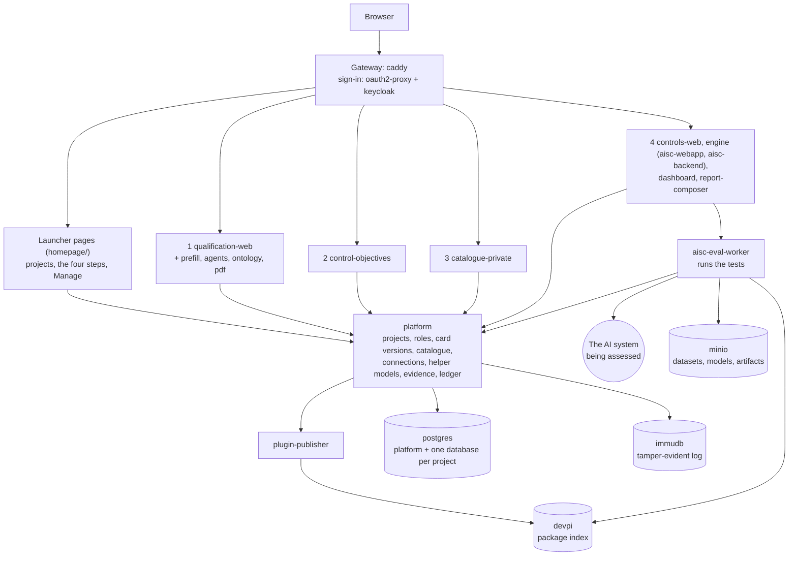

# How AISC works

This document explains what AISC is made of and what each step of an assessment is for. The
[README](../README.md) says how to install it; the [guide](guide.md) is the operator's reference (every component,
setting, port and test). One appendix per step gives that step's details:

- [Appendix 1: Qualify the AI system](appendices/1-qualify.md)
- [Appendix 2: Set control objectives](appendices/2-control-objectives.md)
- [Appendix 3: Choose tests and checklists](appendices/3-tests-and-checklists.md)
- [Appendix 4: Collect evidence](appendices/4-collect-evidence.md)
- [Appendix 5: Manage](appendices/manage.md), the project's settings that every step relies on

## The idea in one paragraph

A project in AISC is the assessment of one AI system. The team first writes down what the system is (step 1), then
decides what it must be checked against (step 2), then picks the checks (step 3), and finally carries them out and
reports on them (step 4). Each step reads what the previous one produced, so the report at the end can say, for one
version of the system, which risks were found, which control objectives they call for, which tests and checklists
cover those objectives, and what the tests and answers showed.

## The four steps and their purpose

| Step | Question it answers | What you do | What it produces | Who uses that next |
|---|---|---|---|---|
| **1. Qualify the AI system** | What is this system, what is it made of, and what can go wrong with it? | Answer the Annex IV questionnaire, list the components, describe the risks; optionally prefill from a document and let an AI assistant suggest additions | The **AI card**, versioned (v1, v2, ...): a graph of the system, its components and its risk chains | Step 2 reads its risks; step 4 assesses the system or one of its components |
| **2. Set control objectives** | Which control objectives must this system meet, and which matter most? | Rate each risk (impact x likelihood), link risks to objectives (by hand or with the AI assistant), pick the key objectives | The **risk and control matrix**: rated risks, the objectives each one calls for, a score and the key objectives | Step 3 filters the catalogue by the objectives' dimensions; step 4 links evidence to the objectives; the report shows them |
| **3. Choose tests and checklists** | Which tests and checklists will produce the evidence? | Choose the project's catalogue once (public or private), filter it by the project's dimensions, install tests and checklists | Tests installed in the engine; checklists installed in the controls app | Step 4 runs and answers them |
| **4. Collect evidence** | What do the tests and the answers show, and how do we report it? | Answer the checklists, run the tests on the system, look at the results, compose and download the report | Checklist answers, test runs and their results, evidence links, reports (PDF or Word) | The people who read the report |

Step 1 does not decide the system's AI Act risk class: Annex III classification is a legal judgement that AISC
leaves to people. The questionnaire has an optional field to tag the Annex III areas that apply.

**The AI card version ties the steps together.** Every save in step 1 makes a new version of the card; earlier
versions stay readable and can no longer change. Step 2 makes one assessment per card version. In step 4 every
checklist answer and every test run is stamped with the version that was latest when it was made, and the page has a
version selector, so results, links and reports are always about one version of the system.

## Architecture

AISC is a set of web applications run together with Docker Compose. They fall into four layers.

### 1. Gateway and sign-in

`caddy` is the only way in. It serves the launcher on port 8100, the step applications and the engine on port 80,
and the dashboard on 8188. On every request it asks `oauth2-proxy` whether the caller is signed in, and sends anyone
who is not to `keycloak` (realm `aisc`). One sign-in covers all ports. Every service also checks the caller's token
itself, through the shared library `aisc_identity`.

### 2. The step applications

Each step is its own application, most of them in a submodule of this repository:

| Step | Application (compose service) | Code |
|---|---|---|
| Launcher | pages served by `caddy` | `homepage/` |
| 1 | `qualification-web` with `qualification-prefill`, `qualification-agents`, `qualification-ontology`, `qualification-pdf` | `apps/qualification` |
| 2 | `control-objectives` | `apps/control-objectives` |
| 3 | `catalogue-private` (the catalogue's pages) | `apps/catalogue` |
| 4, checklists | `controls-web` with `controls-pdf` | `apps/controls` |
| 4, tests | the engine: `aisc-webapp` (pages), `aisc-backend` (API), `aisc-eval-worker` (runs) | `apps/webapp`, `apps/backend`, `apps/eval` |
| 4, results | `dashboard` (Superset) | `apps/results-dashboard`, `dashboard-gateway/` |
| 4, report | `report-composer` (layouts) and `report-renderer` (PDF and Word) | `apps/report-composer`, `apps/report-generator` |

The applications do not call each other freely: what one step needs from another goes through the platform, or is
read from the project's database with a read-only role.

### 3. The platform

`platform` (FastAPI, in `platform/`) is the centre. It owns:

- **projects and roles**: every project's members, each an owner, editor or viewer, and the realm role `admin`,
  which acts as owner of every project; every application asks the platform what the caller may do;
- **one database per project**: creating a project creates `project_<pid>`, in which every step keeps its own
  schema;
- **the AI card versions** that tie the steps together;
- **the project's catalogue** (step 3) and the installs it starts;
- **the connections** to the AI system being assessed, and the **helper models** a test uses as tools;
- the **AI assistants'** models and keys for steps 1 and 2;
- **evidence links**, the step 4 results pages and the dashboards' sync;
- the **ledger**: who changed what, kept in `immudb`.

### 4. Running tests

A test is a Python plugin built on the plugin interface (`shared/plugin-interface`). When an admin installs one from
the catalogue, the platform asks `plugin-publisher` to build it (from its lux-ai-factory repository on GitHub, or
from your own folder in `local_plugins/`) and upload it to the stack's own package index, `devpi`. The engine then
installs it from there. When someone runs a test, `aisc-backend` queues the run and `aisc-eval-worker` (Celery,
through `rabbitmq` and `redis`) installs the plugin's package, runs it and stores its measurements in the project's
database and its files in `minio`.

A plugin never holds the address or key of the system it assesses. It reaches the system through the platform:
the worker gets a short-lived run key, and the plugin calls one of the platform's doors (OpenAI-compatible, A2A, Open
Inference Protocol, or a plain "ask"), which forwards the call to the connection registered under Manage, with its
secrets, its allowed hosts and its timeout. A connection whose system speaks none of the built-in protocols uses an
adapter plugin from `adapters/`. Models the test uses as tools (a judge, an attacker, a grader) are helper models,
registered apart and never what is assessed.

### Where data is kept

| What | Where |
|---|---|
| Projects, members, the ledger's state | `postgres`, database `platform` |
| Everything a project's steps hold | `postgres`, database `project_<pid>`, one schema per step: `qualification`, `control_objectives`, `catalogue`, `controls`, `engine`, `evidence`, `report_composer`, `llm`, `helper`, and `project` (the card versions) |
| Uploaded datasets and models, files a test produces | `minio`, buckets `datasets`, `models`, `artifacts` |
| Built plugin packages | `devpi` (volume `devpi_data`) |
| The tamper-evident log | `immudb`, one database per project |
| Accounts and passwords | `keycloak` |

Removing a project drops its database. Removing the install (`uv run scripts/aisc.py remove`) deletes everything.

## Reading further

- The appendices, one per step: [1](appendices/1-qualify.md), [2](appendices/2-control-objectives.md),
  [3](appendices/3-tests-and-checklists.md), [4](appendices/4-collect-evidence.md), and [Manage](appendices/manage.md).
- [The guide](guide.md): every component, how the stack works in detail, configuration, tests.
- Each submodule's own README, for the application's internals.
